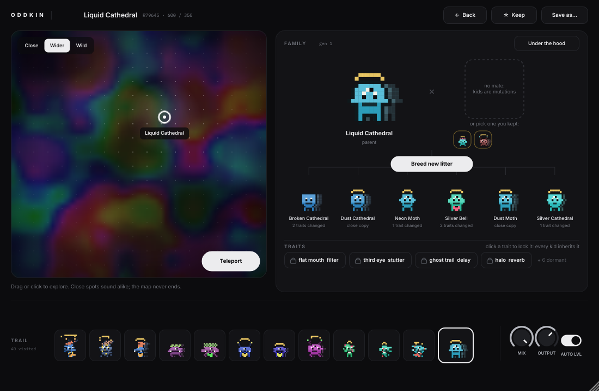

# ODDKIN

*Formerly JACKPOT. Same plug-in: old sessions and presets open in ODDKIN, and installing it removes the old JACKPOT copy.*

### [⬇ Download for Mac](https://github.com/JojoMFKZ/Jackpot/releases/latest/download/ODDKIN-Installer-Mac.pkg) · [⬇ Download for Windows](https://github.com/JojoMFKZ/Jackpot/releases/latest/download/ODDKIN-Installer-Windows.exe)

Open the file and click through. VST3 (+ AU on Mac), works in Ableton Live.
First time only: Mac may say it can't verify the developer (System Settings >
Privacy & Security > Open Anyway); Windows may say "protected your PC" (More info >
Run anyway).

A guitar effect for finding weird, unique sounds without touching a single knob.
Wander an endless map of sounds, breed the ones you like into families of pixel
creatures, and keep your favourites.



## How it works

| | |
|---|---|
| **Map** | Every point is a different patch. Nearby points sound alike, far points don't. The map is endless (Teleport jumps to a new region) and any spot is reproducible. **Close / Wider / Wild** sets how fast sounds change. **Map X / Map Y** are automatable, so a song can wander the map. |
| **Family** | The current sound is a creature. Its six kids are mutations; click one to make it the parent. Pick a kept sound as a **mate** and kids inherit each effect whole from one parent or the other. |
| **Traits** | Every effect is a visible trait: spiky hair = fuzz, glitchy skin = crush, tall/short = pitch, mouth shape = filter, faded and wobbly = tape, third eye = stutter, ghost trail = delay, halo = reverb, antennae = harmony, heart = resonator. Click a trait to **lock** it and every kid and map move keeps it. |
| **Trail** | Every sound you visit. Click to go back; **Back** steps one. |
| **Keep** | Remembers the sound for mating and saves it to `Documents/ODDKIN/Presets`. |
| **Under the hood** | All 71 real parameters, for when you want them. |

### The effects underneath

Fuzz (two-stage clip, starve, octave), Crush (bits, rate, fold, ring mod),
Pitch (granular, ±24 st, spiral feedback), Filter (LP/BP/HP/notch morph,
envelope, LFO), Tape (wow, flutter, saturation, age, dropouts), Stutter (synced
repeats, reverse, warp), Delay (warble, reverse, self-oscillating feedback),
Reverb (shimmer, freeze), Harmony (extra voices as octaves, fifths, major,
minor, sus, maj7 chords), Resonator (tuned strings ringing in a key and chord:
turns noise, drums, synths and fuzz into notes). The first four run in one of
24 orders. The resonator's key never changes as you wander, so it stays in
your song's key. Auto level
and a soft limiter keep wild sounds near your input volume and under 0 dBFS.

## Getting installers

See **START HERE.txt**. Short version: push this folder to GitHub and the
included workflow builds `ODDKIN-Installer-Mac.pkg` and
`ODDKIN-Installer-Windows.exe`, test-installs both, and publishes them as the
latest GitHub Release.
Or run `Build Mac Installer.command` on a Mac / `Build Windows Installer.bat`
on Windows.

### Code signing (optional)

Unsigned installers show a one-time security warning. To remove it on Mac you
need an Apple Developer account; add these repository secrets and the build
signs and notarizes automatically: `MAC_CERTS_P12` (base64 .p12 with your
*Developer ID Application* and *Developer ID Installer* certificates),
`MAC_CERTS_PASSWORD`, `ODDKIN_SIGN_APP_ID`, `ODDKIN_SIGN_INSTALLER_ID`,
`ODDKIN_NOTARY_APPLE_ID`, `ODDKIN_NOTARY_TEAM_ID`, `ODDKIN_NOTARY_PASSWORD`.

## Project layout

```
Source/Params.h          all parameters, ranges, how the generator treats them
Source/DSP.h             the eight effects
Source/Evolution.*       the map, breeding, traits, names and pixel creatures
Source/PluginProcessor.* audio engine, map following, trail/keep, state
Source/PluginEditor.*    the interface
Source/Randomizer.*      per-effect re-roll
Source/PresetManager.*   save / load / starting points
tools/RenderTest.cpp     offline tests: map, breeding, locks, state, 300-sound stress test, UI snapshots
installer/               Mac pkg + uninstaller, Windows Inno Setup script, artwork
```
